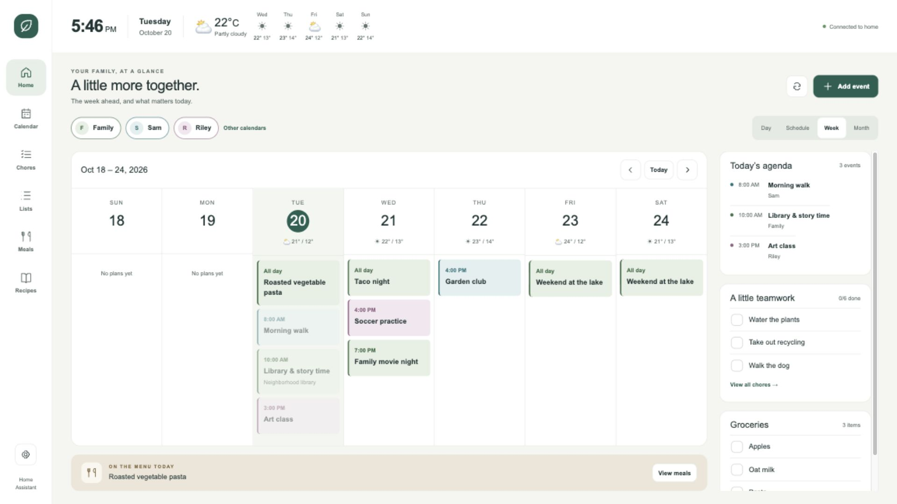
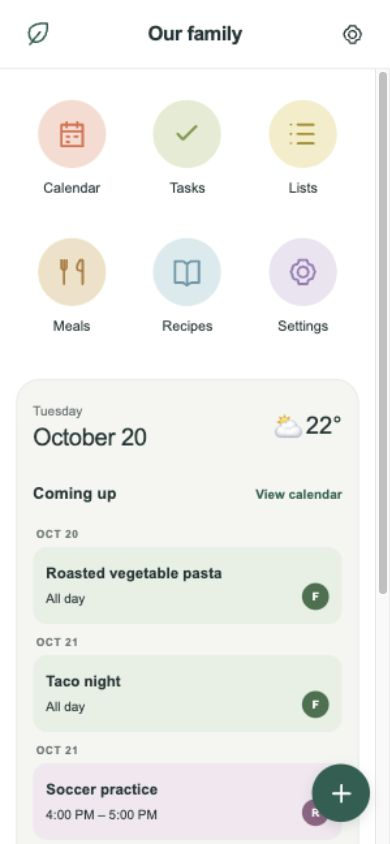

# Hearthglance

A family dashboard for Home Assistant, built for a wall touchscreen and comfortable on a phone.

Calendars, chores, shared lists, meals, recipes, and weather live together in a single native dashboard card. Your existing Home Assistant calendar and to-do integrations hold the data. No separate server, account, or subscription is needed.





## What you get

- Wall calendar with day, week, month, and schedule views, profile colors, and an agenda.
- Phone home screen, calendar agenda, joined multi-day month bars, and a 1–3 day timeline with overlapping appointments.
- Native event creation, editing, and deletion when supported by the calendar integration.
- Per-person chores, shared lists, meal planning, and a recipe book backed by native to-do lists and calendars.
- Optional recurring chore automation, daily weather forecast, dark appearance, and per-display filters.
- A single bundled JavaScript file with no runtime libraries, external fonts, analytics, or direct third-party requests. Calendar integrations may themselves use cloud services.

## Requirements

Home Assistant **2026.10 or newer**, a current browser, and at least one calendar entity. This initial release uses Home Assistant's calendar and to-do WebSocket subscriptions. Earlier HA releases are not supported.

Use a dedicated **panel view** containing only this card. Hearthglance fills the viewport and includes its own navigation. It is not intended for a small card in a grid. Wall layouts were checked at 1920 × 1080; the dedicated phone layout activates at 600 px or narrower. English labels, US date/time formatting, Sunday-start weeks, and the browser's local timezone are currently used. Set the device timezone to match Home Assistant.

A Raspberry Pi Zero W requires a working browser/kiosk environment; installation does not provision the Pi. Performance and physical touch behavior depend on the device/browser and have not been benchmarked on that hardware.

## Install with HACS

This repository is structured as a HACS **Dashboard** repository (internally called `plugin`), not a Supervisor add-on. Repository: **[alexkibler/hearthglance](https://github.com/alexkibler/hearthglance)**.

1. In HACS, open **Custom repositories**, enter `https://github.com/alexkibler/hearthglance`, and select **Dashboard**.
2. Find **Hearthglance**, download it, and reload Home Assistant's frontend.
3. Check **Settings → Dashboards → Resources**. If HACS did not add the resource, add `/hacsfiles/hearthglance/hearthglance-card.js` as a **JavaScript module**. The folder is the repository name; adjust it if you named the repository differently.
4. Create an empty dashboard, open its **Raw configuration editor**, and paste [the minimal example](examples/minimal.yaml). Replace `calendar.family` with your own entity ID.

If Resources is hidden, enable Advanced mode in your Home Assistant profile. Do not load both the HACS resource and a manually installed copy.

HACS's default catalog is a separate submission process; install this project as a custom repository. See [Publishing](docs/publishing.md).

## Manual installation

Copy `dist/hearthglance-card.js` into `/config/www/hearthglance-card/`. Add `/local/hearthglance-card/hearthglance-card.js?v=0.1.0` to dashboard Resources as a **JavaScript module**, then follow step 4 above. No HA restart is needed for the card. Increment the resource query string after replacing the file if your browser retains the old copy.

## Start small

The [minimal dashboard](examples/minimal.yaml) needs just a calendar and one profile. Add optional features when ready. Entity IDs below are examples; creating helpers/integrations does not guarantee those exact IDs. Copy the IDs from Home Assistant.

```yaml
type: custom:hearthglance-card
household: Our family
people:
  - id: family
    name: Family
calendars:
  - entity: calendar.family
    name: Family
    person: family
```

See [the full dashboard example](examples/dashboard.yaml) for multiple people and every feature. Configuration currently uses YAML; there is no visual configuration editor. The card picker can suggest a starter configuration using the first available calendar.

## Add the other features

Create entities through **Settings → Devices & services → Add integration**. Use **Local Calendar** for writable family calendars and the meal calendar, and **Local To-do** for chores, shared lists, and recipes. Existing read-only calendars work for viewing; native integration capabilities determine whether you can add, edit, or delete events. Existing external calendar subscriptions stay managed by their source integration.

| Feature | Configuration | Entity/setup |
| --- | --- | --- |
| Chores | `people[].todo` | A separate Local To-do list per participating profile |
| Shared lists | `lists: [{name, entity}]` | One or more Local To-do lists; the first appears on the wall home screen |
| Meals | A calendar with `kind: meals` | A separate Local Calendar; meal slot and recipe link are stored in event descriptions |
| Recipes | `recipes: todo.recipes` | A separate Local To-do list; ingredients, instructions, and source URL live in descriptions |
| Weather | `weather: weather.home` | A weather entity with a daily forecast |
| Recurring chores | Optional blueprint below | Select the same Local To-do entities used by profiles |

Keep the to-do entities separate across profiles, shared lists, and recipes. Chores require support for due dates and descriptions; Local To-do provides both. Do not use the same calendar for regular events and meals. Navigation tiles appear only for configured features. Recipes may be used without a meal calendar, but planning a recipe requires one.

### Recurring chores

HACS installs the frontend card; it does **not** install automation blueprints automatically.

1. Copy [recurring-chores.yaml](blueprints/automation/recurring-chores.yaml) to `/config/blueprints/automation/hearthglance/recurring-chores.yaml` (or import [the raw blueprint URL](https://raw.githubusercontent.com/alexkibler/hearthglance/main/blueprints/automation/recurring-chores.yaml)).
2. Reload automations, then open **Settings → Automations & scenes → Blueprints**.
3. Create an automation from **Hearthglance - Recurring chores** and select your profiles' Local To-do lists.
4. In Hearthglance, add a chore, set its due date and daily, weekdays, or weekly repeat, and complete it.

The automation runs at 00:05 and on HA startup. A completed chore remains completed for its due day, then reopens when next due. Weekly chores retain their original weekday, even after downtime. Unfinished overdue chores remain unfinished, and one-time tasks stay completed. Without this automation, the repeat label alone does not reopen chores. Avoid creating duplicate automations for the same lists.

## Configuration reference

| Key | Required | Meaning |
| --- | --- | --- |
| `type` | Yes | `custom:hearthglance-card` |
| `people` | Yes | Nonempty array of profiles |
| `people[].id` | Yes | Unique lowercase identifier starting with a letter; letters, numbers, `_`, `-`; `all` is reserved |
| `people[].name` | Yes | Display name |
| `people[].initial` | No | Avatar text; defaults to the first letter |
| `people[].color`, `.pale` | No | `#RGB` or `#RRGGBB`; a palette is supplied by default |
| `people[].todo` | No | This profile's Local To-do chore list |
| `calendars` | Yes | Nonempty array; each needs `entity` |
| `calendars[].name` | No | Label, defaults to the entity's object ID |
| `calendars[].person` | No | Profile ID; defaults to the first profile |
| `calendars[].kind` | No | `meals` for a meal calendar; omit for normal events |
| `calendars[].auxiliary` | No | Show a separate toggle in settings, e.g. holidays |
| `household` | No | Phone home title; defaults to `Our family` |
| `default_calendar` | No | Configured regular calendar preferred when adding events; otherwise first writable calendar |
| `lists` | No | Array of `{name, entity}` shared to-do lists |
| `recipes` | No | Recipe Local To-do entity ID |
| `weather` | No | Daily forecast weather entity |
| `storage_key` | No | Preference namespace; default is derived from configured calendars. Set differently for two dashboards using the same calendars |

Filters, dark appearance, and phone schedule length are stored in the browser, scoped by `storage_key`. Events, tasks, and recipes are saved in Home Assistant through the current user's session and permissions. This card is not an access-control boundary. A wall display needs its own authenticated HA session; no credentials belong in card YAML.

## Known limits and troubleshooting

- **Custom element doesn't exist:** check the module resource URL, remove duplicate resources, and hard refresh the browser.
- **Calendar or list unavailable:** verify the entity ID, HA version, and logged-in user's access. Use Refresh to resubscribe.
- **No edit button:** some integrations allow creation/deletion but not updates. Repeating event series are managed in HA's calendar UI.
- **Changes aren't saved:** an offline connection or integration error is shown; reconnect and retry. There is no offline write queue.
- **Forecast unavailable:** the configured weather provider must support daily forecasts.
- Calendar duplicates with the same title/start/end are collapsed. Search covers displayed dates, not your entire calendar history.
- Do not overwrite JSON descriptions on Hearthglance chores, meal events, or recipes using another app; those descriptions hold the feature metadata. See [Data format](docs/data-format.md).
- Uninstalling the card leaves calendars, lists, and recipes in HA. Remove the optional automation separately if no longer needed.

## Develop and share

```sh
npm ci
npm run check
npm run demo
# Open http://127.0.0.1:8128/examples/demo.html
npm run package
```

The demo is an offline mock of Home Assistant with fictional data. Its writes stay in memory and reset on reload. `npm run package` creates a reproducible ZIP and SHA-256 checksum in `releases/`. The ZIP includes source, bundled card, examples, blueprint, docs, license, and workflows. It excludes local HA configuration, backups, credentials, and dependencies.

See [Contributing](CONTRIBUTING.md), [Publishing](docs/publishing.md), and [Changelog](CHANGELOG.md). MIT licensed.
